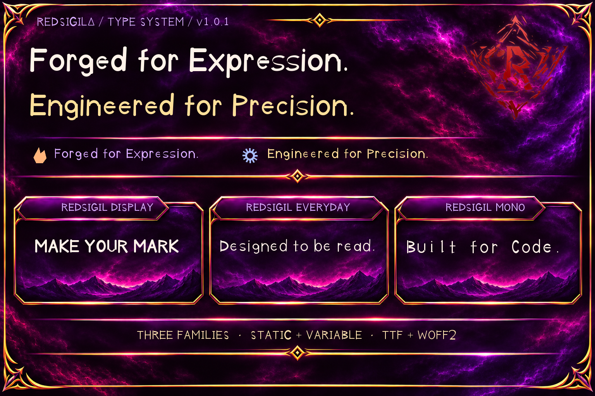
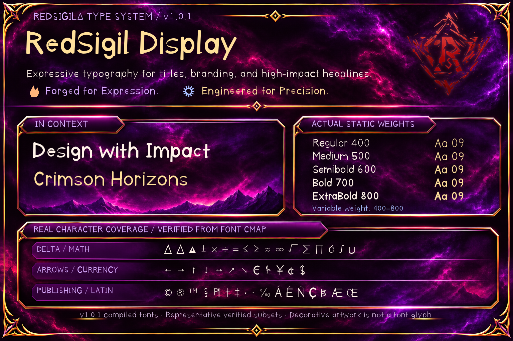
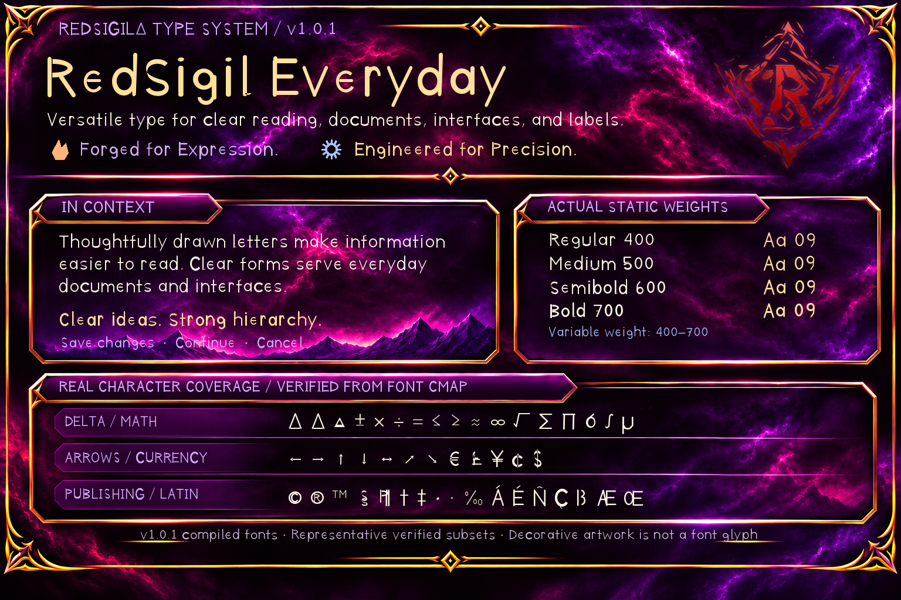
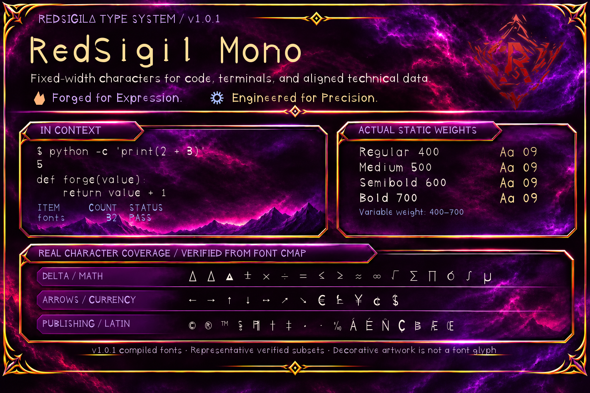
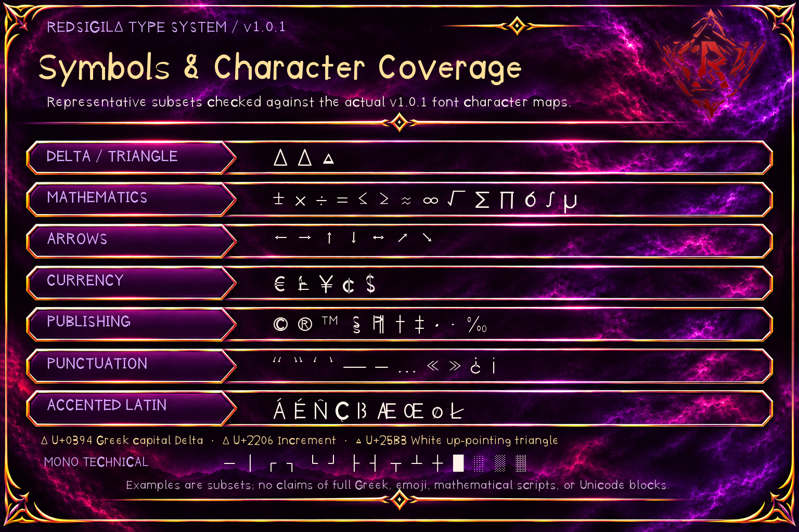

# RedSigilΔ Type System

**🔥 Forged for Expression. ⚙️ Engineered for Precision.**

An open-source typography system comprising **RedSigil Display**, **RedSigil Everyday**, and **RedSigil Mono**, with editable UFO/Designspace sources, static and variable fonts, and web-ready WOFF2 files.

*Rendered with actual compiled v1.0.1 RedSigil fonts on ornate Crimson Mirage artwork; typography is not AI-simulated.*

**Current release: [v1.0.1](https://github.com/RedSigilDelta/RS-Type-System/releases/tag/v1.0.1)** — the Type System's first public release.

## Download

| Package | Contents |
|---|---|
| [01 — Stable Fonts](https://github.com/RedSigilDelta/RS-Type-System/releases/download/v1.0.1/RedSigil_Type_System_01_Stable_Fonts_v1.0.1.zip) | All 32 compiled fonts: static TTF, variable TTF and WOFF2 |
| [02 — Editable Sources](https://github.com/RedSigilDelta/RS-Type-System/releases/download/v1.0.1/RedSigil_Type_System_02_Editable_Sources_v1.0.1.zip) | Seven UFO masters, three Designspaces, build tools and documentation |
| [03 — Complete](https://github.com/RedSigilDelta/RS-Type-System/releases/download/v1.0.1/RedSigil_Type_System_03_Complete_v1.0.1.zip) | Editable source and compiled fonts together |
| [04 — Release Verification](https://github.com/RedSigilDelta/RS-Type-System/releases/download/v1.0.1/RedSigil_Type_System_04_Release_Verification_v1.0.1.zip) | Build provenance, font/package hashes and verification evidence |

A [SHA-256 checksum sidecar](https://github.com/RedSigilDelta/RS-Type-System/releases/download/v1.0.1/SHA256SUMS_v1.0.1.txt) covers all four ZIP files. Source users can clone this repository directly instead of downloading Package 02.

## Families and formats

| Family | UFO masters | Static TTF | Variable TTF | WOFF2 |
|---|---:|---:|---:|---:|
| RedSigil Display | 3 | 5 | 1 | 6 |
| RedSigil Everyday | 2 | 4 | 1 | 5 |
| RedSigil Mono | 2 | 4 | 1 | 5 |
| **Total** | **7** | **13** | **3** | **16** |

## Meet the font families

### RedSigil Display

Built for **headlines, branding, posters, titles, and prominent visual statements**. Display offers five static weights—Regular (400), Medium (500), Semibold (600), Bold (700), and ExtraBold (800)—plus one variable font spanning **400–800**.

### RedSigil Everyday

Built for **documents, articles, user interfaces, labels, and readable everyday text**. Everyday offers four static weights—Regular (400), Medium (500), Semibold (600), and Bold (700)—plus one variable font spanning **400–700**.

### RedSigil Mono

Built for **source code, terminals, aligned numbers, tabular technical data, and fixed-width formatting**. Mono offers four static weights—Regular (400), Medium (500), Semibold (600), and Bold (700)—plus one variable font spanning **400–700**.

## Symbols and characters

The v1.0.1 families include the separate glyph identities **Δ** (Greek capital Delta), **∆** (mathematical increment), and **△** (white up-pointing triangle). The font character maps also contain selected mathematical operators, arrows, monetary symbols, publishing marks, accented Latin letters, and punctuation. The specimens only show glyphs actually present in the compiled fonts; they do **not** imply full Greek, comprehensive mathematical notation, or emoji support.

Specimen lettering is rendered using genuine static TTF files from the verified GitHub Actions build. Ornamental backgrounds and the textured sigil are separate **All Rights Reserved** visual assets; the public repository includes the approved final PNGs, not the original editable artwork plates. See [Font Specimens](docs/FONT_SPECIMENS.md) for coverage notes, rendering reproducibility and the exact Crimson Mirage colors, and [Font Families](docs/FONT_FAMILIES.md) for the master/source details.

## OpenType and glyph repertoire

The stable foundation already includes **GSUB `ccmp` and `locl`** for all three families and **GPOS `mark` and `mkmk`** for combining-mark positioning. Display and Everyday also include **GPOS `kern`**. Mono includes the additional **`ss01` and `zero`** substitution features, plus extra characters intended for programming and terminal use, such as box-drawing and block symbols. Features only take effect when supported by the application rendering the font.

In the archived v1.0.0 binaries, Display and Everyday had **372 Unicode mappings** per style; Mono had **532**. v1.0.1 builds on that repertoire and adds Greek capital **Δ**. These numbers describe actual mapped code points, not universal language support. [Font specimens](docs/FONT_SPECIMENS.md) and the [changelog](CHANGELOG.md) provide additional detail.

## What changed in v1.0.1

The original **v1.0.0** stable foundation established all three font families, seven editable masters, three Designspaces and the 32-font distribution. That engineering milestone was maintained privately; v1.0.1 is the first release published from this repository.

**v1.0.1** adds a genuine, independently encoded Greek capital **Δ** (U+0394) to every UFO master. It remains separate from mathematical increment **∆** (U+2206) and white up-pointing triangle **△** (U+25B3). Delta and increment share their initial contours and advance widths, but not glyph identity. This does **not** imply complete Greek-language support. All master and compiled font versions are **1.001**.

See [Changelog](CHANGELOG.md) and [Release Notes](RELEASE_NOTES.md).

## Build and verify

- Sources: `sources/{display,everyday,mono}/` — seven UFO masters and three Designspaces.
- Build scripts and pinned direct dependencies: `build/`.
- Source/compiled verification and Greek Delta tests: `tools/`.
- Reproducible package assembler: `release/make_release.py`.
- Manual GitHub Actions production workflow: `.github/workflows/stable-font-build.yml`.

The production build from source commit `c956f7fc483a8a2d5bf6af8b35a643e8d3147a24` succeeded in [GitHub Actions run 42104786087](https://github.com/RedSigilDelta/RS-Type-System/actions/runs/42104786087). The downloaded 32-font artifact passed local compiled verification and all 32 file checksum rechecks. See [Building](docs/BUILDING.md), [Verification](docs/VERIFICATION.md), [Provenance](docs/PROVENANCE.md), and [Source Structure](docs/SOURCE_STRUCTURE.md).

**Case-sensitive filesystem required for editable sources.** GLIF filenames may differ only by case. Do not extract UFO masters onto a filesystem that folds such names together.

## Licensing

- **Font Software and editable font sources:** SIL Open Font License 1.1, Reserved Font Name **RedSigil**.
- **Original build, verification and release scripts, plus the GitHub Actions workflow:** MIT.
- **Original project documentation:** MIT (using the same license text as the original project tools).
- **Specimen illustrations and textured sigil:** All Rights Reserved; publication of the specimen PNGs does not grant an independent artwork reuse license.
- **Third-party dependencies:** Their respective upstream licenses.

See [LICENSES.md](LICENSES.md) and `licenses/` for the license boundaries and notices. None of these licenses changes the licensing of third-party build dependencies.
